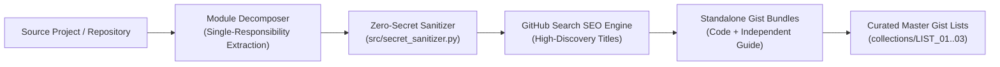

# 🏛️ GITHUB-GIST-ARCHITECT

<div align="center">

[-2563EB?style=for-the-badge)](./README.md)
[-10B981?style=for-the-badge)](./README_AR.md)

[](#%EF%B8%8F-5-zero-secret-sanitization-engine)
[](#%EF%B8%8F-2-curated-master-gist-lists-collections)
[](#%EF%B8%8F-4-ai-agent-skill--slash-command-gistify)

**An Automated Project-to-Gist Engineering Suite, Zero-Secret Sanitizer, SEO-Indexed Gist Catalog, Curated Master Lists, and AI Agent Skill (`/gistify`) for Turning Any Codebase into Clean, Discoverable GitHub Gists.**

[🇬🇧 English Documentation (Current)](./README.md) · [🇸🇦 الدليل العربي الشامل (`README_AR.md`)](./README_AR.md) · [📐 Architecture & Plan (`docs/PLAN_AND_ARCHITECTURE_AR.md`)](./docs/PLAN_AND_ARCHITECTURE_AR.md) · [📚 Master Catalog (`collections/`)](./collections/00_MASTER_GIST_CATALOG.md) · [🤖 AI Skill (`SKILL.md`)](./skills/project-to-gist-converter/SKILL.md)

</div>

---

## 🌟 1. Overview & Purpose

**`GITHUB-GIST-ARCHITECT`** solves three critical challenges developers face when sharing reusable scripts and automation workflows on **GitHub Gist**:

1. **Zero-Secret Guarantee (`100% Token & PII Sanitization`):** Automatically scans and strips all Personal Access Tokens (`ghp_`, `github_pat_`, `gho_`), Cloud/AI keys (`AKIA`, `sk-`), Bearer headers, personal email addresses, and account handles before any code leaves your machine—replacing them with clean, standardized placeholders (`[YOUR_GITHUB_TOKEN]`, `[YOUR_GITHUB_USERNAME]`).
2. **Maximum GitHub Search Discoverability (`SEO-Optimized Titles`):** Crafts crystal-clear, keyword-rich Gist titles (`[Action Verb] + [Target Platform/API] + [Core Technique] + ([Language])`) so developers searching GitHub immediately find and benefit from your Gists.
3. **Curated Master Gist Lists (`Task-Oriented Collections`):** Because GitHub Gist does not natively support folders, this system groups related Gists into **Master Task Lists (Collections)**—each powered by an index Markdown table that links every constituent Gist of a complex workflow.



---

## 🗂️ 2. Curated Master Gist Lists (Collections)

To organize multi-script systems cleanly, all 10 Gists are grouped into **3 Master Task Lists**:

| List ID | Master Collection Name & Scope | Gists Included | Collection Index |
| :-: | :--- | :-: | :---: |
| **List 01** | **GitHub Profile Live Telemetry & Dynamic SVG Suite**<br/>_End-to-end automation for live contribution metrics, custom `Midnight Galaxy` SVG cards, 3D spiral repo galaxies, and 6-hour cron workflows._ | `4 Gists` (`#01` – `#04`) | [📂 Open List 01](./collections/LIST_01_PROFILE_TELEMETRY_AND_SVG.md) |
| **List 02** | **GraphQL GPG-Verified PR, Co-Author & Achievements Engine**<br/>_Server-side GPG-signed commits (`isValid=true`) via `createCommitOnBranch`, automated Pull Request merges, Discussions Q&A resolution, and badge auditing._ | `3 Gists` (`#05` – `#07`) | [📂 Open List 02](./collections/LIST_02_PR_AND_ACHIEVEMENTS_ENGINE.md) |
| **List 03** | **Community Repository Scanner, CI/CD Guard & Secret Sanitizer**<br/>_Open-source repository discovery by star/follower ranges, zero-leak token sanitization prior to Gist publishing, and idempotent CI/CD release guards._ | `3 Gists` (`#08` – `#10`) | [📂 Open List 03](./collections/LIST_03_COMMUNITY_SCANNER_AND_SECURITY.md) |

> 📌 **Master Catalog Index:** View all 3 collections and their execution order in [`collections/00_MASTER_GIST_CATALOG.md`](./collections/00_MASTER_GIST_CATALOG.md).

---

## 📋 3. Complete Catalog of All 10 Sanitized, SEO-Optimized Gists

Every Gist below is **100% free of personal tokens or credentials** and includes both a standalone production-ready script and a dedicated documentation guide:

| # | Collection | Search-Optimized Gist Title (SEO Title) & Function | Clean Code File | Guide |
| :-: | :---: | :--- | :---: | :---: |
| **01** | `List 01` | **Auto-Update GitHub Profile README Live Contributions & Streak Stats via GraphQL (Python)**<br/>_Queries multi-year `contributionsCollection` calendars via GraphQL, computes exact current/longest streaks, and updates `README.md` with cache-busting timestamps._ | [`github_profile_live_metrics_sync.py`](./gists/01_profile_live_metrics_sync/github_profile_live_metrics_sync.py) | [Guide](./gists/01_profile_live_metrics_sync/00_01_profile_live_metrics_sync_GUIDE_AR.md) |
| **02** | `List 01` | **Generate Custom GitHub Streak & Achievements Trophy SVG Cards Locally (Midnight Galaxy Theme - Python)**<br/>_Generates responsive `streak-stats.svg` and trophy cards locally in a unified `#060B1E` / `#5B5C8A` / `#FACC15` Midnight Galaxy theme with zero external uptime dependencies._ | [`github_custom_svg_cards_generator.py`](./gists/02_custom_svg_cards_generator/github_custom_svg_cards_generator.py) | [Guide](./gists/02_custom_svg_cards_generator/00_02_custom_svg_cards_generator_GUIDE_AR.md) |
| **03** | `List 01` | **Generate Interactive 3D Spiral Galaxy SVG of GitHub Repositories & Languages (Python)**<br/>_Renders an astronomical spiral galaxy (`repo-galaxy.svg`) where each repository is plotted along logarithmic spiral arms colored by primary language and sized by star count._ | [`github_repo_galaxy_svg_visualizer.py`](./gists/03_repo_galaxy_svg_visualizer/github_repo_galaxy_svg_visualizer.py) | [Guide](./gists/03_repo_galaxy_svg_visualizer/00_03_repo_galaxy_svg_visualizer_GUIDE_AR.md) |
| **04** | `List 01` | **GitHub Actions Cron Workflow to Auto-Sync Profile README Stats Every 6 Hours (YAML)**<br/>_Production-ready GitHub Actions workflow triggered every 6 hours (`0 */6 * * *`) and via `workflow_dispatch` with `[skip ci]` loop prevention._ | [`profile-metrics-auto-sync.yml`](./gists/04_github_actions_profile_cron/profile-metrics-auto-sync.yml) | [Guide](./gists/04_github_actions_profile_cron/00_04_github_actions_profile_cron_GUIDE_AR.md) |
| **05** | `List 02` | **Create GPG-Verified GitHub Commits & Pull Requests via GraphQL createCommitOnBranch (Python)**<br/>_Creates commits signed directly by GitHub's official GPG key (`signature.isValid = true`) with optional `Co-authored-by:` trailers and merges PRs via GraphQL._ | [`github_graphql_gpg_verified_pr_engine.py`](./gists/05_graphql_gpg_verified_pr_engine/github_graphql_gpg_verified_pr_engine.py) | [Guide](./gists/05_graphql_gpg_verified_pr_engine/00_05_graphql_gpg_verified_pr_engine_GUIDE_AR.md) |
| **06** | `List 02` | **Create Answered GitHub Discussions & Mark Accepted Answer via GraphQL API (Python)**<br/>_Automates Q&A knowledge base entries by creating a Discussion, posting a comprehensive reply, and marking it as the accepted answer (`markDiscussionCommentAsAnswer`)._ | [`github_graphql_discussion_answer_automator.py`](./gists/06_graphql_discussion_answer_automator/github_graphql_discussion_answer_automator.py) | [Guide](./gists/06_graphql_discussion_answer_automator/00_06_graphql_discussion_answer_automator_GUIDE_AR.md) |
| **07** | `List 02` | **Audit GitHub Profile Achievements & Merged PR Signature Status via GraphQL (Python)**<br/>_Audits merged Pull Requests across repositories to verify GPG signature validity (`isValid`), committer identity, co-author trailers, and achievement badge unlocks._ | [`github_achievements_progress_auditor.py`](./gists/07_github_achievements_progress_auditor/github_achievements_progress_auditor.py) | [Guide](./gists/07_github_achievements_progress_auditor/00_07_github_achievements_progress_auditor_GUIDE_AR.md) |
| **08** | `List 03` | **Discover Active Open-Source GitHub Repositories by Star Count & Owner Followers (Python)**<br/>_Queries the GitHub Search API for active repositories within a target star range (`0..200`) and filters owners by follower count (`50..500`) for high-response collaboration._ | [`github_community_repo_discovery_scanner.py`](./gists/08_community_repo_discovery_scanner/github_community_repo_discovery_scanner.py) | [Guide](./gists/08_community_repo_discovery_scanner/00_08_community_repo_discovery_scanner_GUIDE_AR.md) |
| **09** | `List 03` | **Sanitize Code Files & Strip API Tokens, PATs, and Personal Emails Before Publishing Gists (Python)**<br/>_Pre-flight security scanner and redactor that strips tokens, secrets, and personal identifiers from source files and raises an error if any leak pattern remains._ | [`gist_secret_and_token_sanitizer.py`](./gists/09_code_secret_and_token_sanitizer/gist_secret_and_token_sanitizer.py) | [Guide](./gists/09_code_secret_and_token_sanitizer/00_09_code_secret_and_token_sanitizer_GUIDE_AR.md) |
| **10** | `List 03` | **Fix GitHub Actions Release Republish Failure with Pre-Flight HTTP 200 Check (Bash / YAML)**<br/>_Prevents CI/CD deploy pipelines from failing when re-running on an already-published version by performing an idempotent `curl` HTTP `200 OK` check before upload._ | [`ci_idempotent_publish_guard.sh`](./gists/10_actions_binary_republish_guard/ci_idempotent_publish_guard.sh) | [Guide](./gists/10_actions_binary_republish_guard/00_10_actions_binary_republish_guard_GUIDE_AR.md) |

---

## 🛠️ 4. AI Agent Skill & Slash Command (`/gistify`)

This repository includes a portable **AI Agent Skill** and **Slash Command** compatible with **Antigravity**, **Claude Code**, **Cursor**, **Windsurf**, and **OpenCode** (`agentskills.io` standard):

* **Standard Skill Definition:** [`skills/project-to-gist-converter/SKILL.md`](./skills/project-to-gist-converter/SKILL.md)
* **Cross-Agent Discovery Mirror:** [`.agents/skills/project-to-gist-converter/SKILL.md`](./.agents/skills/project-to-gist-converter/SKILL.md)
* **Slash Command (`/gistify`):** [`.claude/commands/gistify.md`](./.claude/commands/gistify.md)

### How to Trigger the AI Skill on Any Project
Simply prompt your AI assistant with:
```text
/gistify ./path/to/your/project
```
or in natural language:
```text
Use the project-to-gist-converter skill to analyze this project, strip all tokens and personal data, and convert every module into SEO-titled Gists grouped into Master Gist Lists.
```

### How to Run the Automated Converter via CLI
You can also invoke the Python converter directly on any project directory:
```bash
python src/project_to_gist_converter.py \
  --source ./path/to/your/project \
  --output ./dist_gists \
  --strip-user "YOUR_HANDLE_TO_REDACT"
```

---

## 🛡️ 5. Zero-Secret Sanitization Engine

Before any file is packaged into `gists/`, [`src/secret_sanitizer.py`](./src/secret_sanitizer.py) enforces a strict multi-rule regex sanitization pass (`sanitize_content` + `assert_clean_for_gist`):

| Secret / Identifier Category | Detected Pattern | Safe Replacement Placeholder |
| :--- | :--- | :--- |
| **GitHub Classic & OAuth Tokens** | `gh[pousr]_[A-Za-z0-9_]{20,255}` | `[YOUR_GITHUB_TOKEN]` |
| **GitHub Fine-Grained PATs** | `github_pat_[A-Za-z0-9_]{20,255}` | `[YOUR_GITHUB_TOKEN]` |
| **OpenAI / LLM API Keys** | `sk-[A-Za-z0-9\-_]{20,255}` | `[YOUR_OPENAI_API_KEY]` |
| **AWS Access Key IDs** | `AKIA[0-9A-Z]{16}` | `[YOUR_AWS_ACCESS_KEY_ID]` |
| **Authorization Bearer Headers** | `Bearer <secret>` | `Bearer [YOUR_API_TOKEN]` |
| **Personal Email Addresses** | `user@domain.tld` | `YOUR_ID+YOUR_USERNAME@users.noreply.github.com` |
| **Account Usernames** | Custom `--strip-user` list | `[YOUR_GITHUB_USERNAME]` |

Run the standalone verification audit across any directory at any time:
```bash
python src/secret_sanitizer.py ./gists
```

---

## 🚀 6. Publishing All Gists to `gist.github.com` (1-Click Script)

To publish all 10 Gists plus the **Master Index Gist (`00_MASTER_GIST_LIST.md`)** directly to your live `https://gist.github.com/` account, run:

```powershell
powershell -ExecutionPolicy Bypass -File .\scripts\Publish-AllGists.ps1
```
> **Automatic OAuth Scope Check:** If your local Git Credential Manager token currently has `repo, workflow` scopes without `gist`, `Publish-AllGists.ps1` automatically launches a 1-click GitHub Device Flow prompt to grant the `gist` scope and publishes the entire catalog.

---

## 📂 7. Repository Structure

```text
GITHUB-GIST-ARCHITECT/
├── README.md                                 # Primary Documentation (English)
├── README_AR.md                              # Secondary Documentation (Arabic Translation)
├── docs/
│   └── PLAN_AND_ARCHITECTURE_AR.md           # Full Engineering Blueprint & SEO Strategy
├── collections/                              # Curated Master Gist Lists (By Major Task)
│   ├── 00_MASTER_GIST_CATALOG.md             # Master Index of All Collections & Gists
│   ├── LIST_01_PROFILE_TELEMETRY_AND_SVG.md  # List 01: Profile Telemetry & SVG Suite (4 Gists)
│   ├── LIST_02_PR_AND_ACHIEVEMENTS_ENGINE.md # List 02: GraphQL GPG PR & Achievements Suite (3 Gists)
│   └── LIST_03_COMMUNITY_SCANNER_AND_SECURITY.md # List 03: Community Scanner & Security Suite (3 Gists)
├── gists/                                    # 10 Sanitized Gist Bundles (Code + Standalone Guide)
│   ├── gist_catalog_manifest.json            # Machine-readable catalog manifest
│   ├── 01_profile_live_metrics_sync/
│   ├── 02_custom_svg_cards_generator/
│   ├── 03_repo_galaxy_svg_visualizer/
│   ├── 04_github_actions_profile_cron/
│   ├── 05_graphql_gpg_verified_pr_engine/
│   ├── 06_graphql_discussion_answer_automator/
│   ├── 07_github_achievements_progress_auditor/
│   ├── 08_community_repo_discovery_scanner/
│   ├── 09_code_secret_and_token_sanitizer/
│   └── 10_actions_binary_republish_guard/
├── src/                                      # Core Sanitizer & Converter Engine
│   ├── secret_sanitizer.py                   # Zero-secret regex redactor & auditor
│   └── project_to_gist_converter.py          # Automated Project-to-Gist CLI converter
├── skills/
│   └── project-to-gist-converter/
│       └── SKILL.md                          # Official AI Agent Skill definition
├── .claude/commands/
│   └── gistify.md                            # /gistify slash command definition
└── scripts/
    └── Publish-AllGists.ps1                  # 1-Click Gist publisher with OAuth scope upgrader
```
