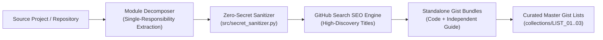

# 🏛️ GITHUB-GIST-ARCHITECT

<div align="center">

[-2563EB?style=for-the-badge)](./README.md)
[-10B981?style=for-the-badge)](./README_AR.md)
[](./LICENSE)

[](#%EF%B8%8F-6-zero-secret-sanitization-engine)
[](#%EF%B8%8F-3-curated-master-gist-lists-collections)
[](#%EF%B8%8F-5-ai-agent-skill--slash-command-gistify)

### 🛠️ Built With (Languages & Technologies)


**An Automated Project-to-Gist Engineering Suite, Zero-Secret Sanitizer, SEO-Indexed Gist Catalog, Curated Master Lists, and AI Agent Skill (`/gistify`) for Turning Any Codebase into Clean, Discoverable GitHub Gists.**

[🇬🇧 English Documentation (Current)](./README.md) · [🇸🇦 الدليل العربي الشامل (`README_AR.md`)](./README_AR.md) · [📐 Architecture & Plan (`docs/PLAN_AND_ARCHITECTURE_AR.md`)](./docs/PLAN_AND_ARCHITECTURE_AR.md) · [📚 Master Catalog (`collections/`)](./collections/00_MASTER_GIST_CATALOG.md) · [🤖 AI Skill (`SKILL.md`)](./skills/project-to-gist-converter/SKILL.md) · [⚖️ MIT License (`LICENSE`)](./LICENSE)

</div>

---

## 🌟 1. Overview & Purpose

**`GITHUB-GIST-ARCHITECT`** solves three critical challenges developers face when sharing reusable scripts and automation workflows on **GitHub Gist**:

1. **Zero-Secret Guarantee (`100% Token & PII Sanitization`):** Automatically scans and strips all Personal Access Tokens (`ghp_`, `github_pat_`, `gho_`), Cloud/AI keys (`AKIA`, `sk-`), Bearer headers, personal email addresses, and account handles before any code leaves your machine—replacing them with clean, standardized placeholders (`[YOUR_GITHUB_TOKEN]`, `[YOUR_GITHUB_USERNAME]`).
2. **Maximum GitHub Search Discoverability (`SEO-Optimized Titles`):** Crafts crystal-clear, keyword-rich Gist titles (`[Action Verb] + [Target Platform/API] + [Core Technique] + ([Language])`) so developers searching GitHub immediately find and benefit from your Gists.
3. **Curated Master Gist Lists (`Task-Oriented Collections`):** Because GitHub Gist does not natively support folders, this system groups related Gists into **Master Task Lists (Collections)**—each powered by an index Markdown table that links every constituent Gist of a complex workflow.



---

## 🛠️ 2. Languages & Technologies Used

| Language / Technology | Role in This Project | Key Modules / Files |
| :--- | :--- | :--- |
| **Python 3.10+** | Core sanitization engine, AST/module converter, GraphQL/REST telemetry, GPG PR engine, and SVG generators | [`src/secret_sanitizer.py`](./src/secret_sanitizer.py), [`src/project_to_gist_converter.py`](./src/project_to_gist_converter.py), `gists/01..03`, `gists/05..09` |
| **PowerShell** | Automated OAuth Device Flow scope upgrader (`gist` scope) and 1-click batch publisher to `gist.github.com` | [`scripts/Publish-AllGists.ps1`](./scripts/Publish-AllGists.ps1) |
| **Bash / POSIX Shell** | Idempotent pre-flight HTTP `200 OK` release guard for CI/CD binary publishing | [`gists/10_actions_binary_republish_guard/ci_idempotent_publish_guard.sh`](./gists/10_actions_binary_republish_guard/ci_idempotent_publish_guard.sh) |
| **YAML (GitHub Actions)** | Scheduled 6-hour cron workflow for autonomous profile metrics and SVG synchronization | [`gists/04_github_actions_profile_cron/profile-metrics-auto-sync.yml`](./gists/04_github_actions_profile_cron/profile-metrics-auto-sync.yml) |
| **GitHub GraphQL API v4** | Server-side GPG-verified commits (`createCommitOnBranch`), multi-year `contributionsCollection`, and Q&A Discussions resolution | `gists/01`, `gists/05`, `gists/06`, `gists/07` |
| **GitHub REST API v3** | Repository discovery search, OAuth scope verification, Topics management, and Gist publishing | `gists/08`, `scripts/Publish-AllGists.ps1` |
| **Dynamic SVG Vector Graphics** | Zero-dependency generation of `Midnight Galaxy` streak cards and 3D logarithmic spiral repository galaxies | `gists/02`, `gists/03` |
| **AI Agent Skill (`SKILL.md`)** | Portable `agentskills.io` & `/gistify` slash command for Claude Code, Antigravity, Cursor, and OpenCode | [`skills/project-to-gist-converter/SKILL.md`](./skills/project-to-gist-converter/SKILL.md), [`.claude/commands/gistify.md`](./.claude/commands/gistify.md) |

---

## 🗂️ 3. Curated Master Gist Lists (Collections)

To organize multi-script systems cleanly, all 10 Gists are grouped into **3 Master Task Lists**:

| List ID | Master Collection Name & Scope | Gists Included | Repo Collection | Live Gist List |
| :-: | :--- | :-: | :---: | :---: |
| **Master** | **Master GitHub Automation & Profile Engineering Gist Catalog**<br/>_Unified index of all 3 task collections and all 10 sanitized Gists._ | `All 10 Gists` | [📂 Catalog](./collections/00_MASTER_GIST_CATALOG.md) | [🌐 Live Gist](https://gist.github.com/1stANUNNAKI/b1b31e4a7f0a089ed7927620dedbdea5) |
| **List 01** | **GitHub Profile Live Telemetry & Dynamic SVG Suite**<br/>_End-to-end automation for live contribution metrics, custom `Midnight Galaxy` SVG cards, 3D spiral repo galaxies, and 6-hour cron workflows._ | `4 Gists` (`#01` – `#04`) | [📂 List 01](./collections/LIST_01_PROFILE_TELEMETRY_AND_SVG.md) | [🌐 Live Gist](https://gist.github.com/1stANUNNAKI/92f026f01535f414e4cfb76cd0720c01) |
| **List 02** | **GraphQL GPG-Verified PR, Co-Author & Achievements Engine**<br/>_Server-side GPG-signed commits (`isValid=true`) via `createCommitOnBranch`, automated Pull Request merges, Discussions Q&A resolution, and badge auditing._ | `3 Gists` (`#05` – `#07`) | [📂 List 02](./collections/LIST_02_PR_AND_ACHIEVEMENTS_ENGINE.md) | [🌐 Live Gist](https://gist.github.com/1stANUNNAKI/d1ffe609069f8df2c2494a6596859cb6) |
| **List 03** | **Community Repository Scanner, CI/CD Guard & Secret Sanitizer**<br/>_Open-source repository discovery by star/follower ranges, zero-leak token sanitization prior to Gist publishing, and idempotent CI/CD release guards._ | `3 Gists` (`#08` – `#10`) | [📂 List 03](./collections/LIST_03_COMMUNITY_SCANNER_AND_SECURITY.md) | [🌐 Live Gist](https://gist.github.com/1stANUNNAKI/07da8d4b142b6dba5c52bdff10a63930) |

---

## 📋 4. Complete Catalog of All 10 Sanitized, SEO-Optimized Gists

Every Gist below is **100% free of personal tokens or credentials** and includes a standalone production-ready script, an English guide, and an Arabic guide:

| # | Collection | Search-Optimized Gist Title (SEO Title) & Function | Clean Code File | Live Gist on `gist.github.com` |
| :-: | :---: | :--- | :---: | :---: |
| **01** | `List 01` | **Auto-Update GitHub Profile README Live Contributions & Streak Stats via GraphQL (Python)**<br/>_Queries multi-year `contributionsCollection` calendars via GraphQL, computes exact current/longest streaks, and updates `README.md` with cache-busting timestamps._ | [`github_profile_live_metrics_sync.py`](./gists/01_profile_live_metrics_sync/github_profile_live_metrics_sync.py) | [🌐 Open Gist #01](https://gist.github.com/1stANUNNAKI/4780a35129ec55227e736bba715e3f73) |
| **02** | `List 01` | **Generate Custom GitHub Streak & Achievements Trophy SVG Cards Locally (Midnight Galaxy Theme - Python)**<br/>_Generates responsive `streak-stats.svg` and trophy cards locally in a unified `#060B1E` / `#5B5C8A` / `#FACC15` Midnight Galaxy theme with zero external uptime dependencies._ | [`github_custom_svg_cards_generator.py`](./gists/02_custom_svg_cards_generator/github_custom_svg_cards_generator.py) | [🌐 Open Gist #02](https://gist.github.com/1stANUNNAKI/6bf795c7841b69a11dc2eb97f0aaefbe) |
| **03** | `List 01` | **Generate Interactive 3D Spiral Galaxy SVG of GitHub Repositories & Languages (Python)**<br/>_Renders an astronomical spiral galaxy (`repo-galaxy.svg`) where each repository is plotted along logarithmic spiral arms colored by primary language and sized by star count._ | [`github_repo_galaxy_svg_visualizer.py`](./gists/03_repo_galaxy_svg_visualizer/github_repo_galaxy_svg_visualizer.py) | [🌐 Open Gist #03](https://gist.github.com/1stANUNNAKI/d7f8a4a289e50e71bb24be84397a53da) |
| **04** | `List 01` | **GitHub Actions Cron Workflow to Auto-Sync Profile README Stats Every 6 Hours (YAML)**<br/>_Production-ready GitHub Actions workflow triggered every 6 hours (`0 */6 * * *`) and via `workflow_dispatch` with `[skip ci]` loop prevention._ | [`profile-metrics-auto-sync.yml`](./gists/04_github_actions_profile_cron/profile-metrics-auto-sync.yml) | [🌐 Open Gist #04](https://gist.github.com/1stANUNNAKI/c2de940528a5bb678e534529746694b0) |
| **05** | `List 02` | **Create GPG-Verified GitHub Commits & Pull Requests via GraphQL createCommitOnBranch (Python)**<br/>_Creates commits signed directly by GitHub's official GPG key (`signature.isValid = true`) with optional `Co-authored-by:` trailers and merges PRs via GraphQL._ | [`github_graphql_gpg_verified_pr_engine.py`](./gists/05_graphql_gpg_verified_pr_engine/github_graphql_gpg_verified_pr_engine.py) | [🌐 Open Gist #05](https://gist.github.com/1stANUNNAKI/62f2233c827774d1c1ca9b948d09ee8b) |
| **06** | `List 02` | **Create Answered GitHub Discussions & Mark Accepted Answer via GraphQL API (Python)**<br/>_Automates Q&A knowledge base entries by creating a Discussion, posting a comprehensive reply, and marking it as the accepted answer (`markDiscussionCommentAsAnswer`)._ | [`github_graphql_discussion_answer_automator.py`](./gists/06_graphql_discussion_answer_automator/github_graphql_discussion_answer_automator.py) | [🌐 Open Gist #06](https://gist.github.com/1stANUNNAKI/a0e2150fc82fdf18d772769450a4d257) |
| **07** | `List 02` | **Audit GitHub Profile Achievements & Merged PR Signature Status via GraphQL (Python)**<br/>_Audits merged Pull Requests across repositories to verify GPG signature validity (`isValid`), committer identity, co-author trailers, and achievement badge unlocks._ | [`github_achievements_progress_auditor.py`](./gists/07_github_achievements_progress_auditor/github_achievements_progress_auditor.py) | [🌐 Open Gist #07](https://gist.github.com/1stANUNNAKI/d08890ebf4c009c6693519da37b2ae1f) |
| **08** | `List 03` | **Discover Active Open-Source GitHub Repositories by Star Count & Owner Followers (Python)**<br/>_Queries the GitHub Search API for active repositories within a target star range (`0..200`) and filters owners by follower count (`50..500`) for high-response collaboration._ | [`github_community_repo_discovery_scanner.py`](./gists/08_community_repo_discovery_scanner/github_community_repo_discovery_scanner.py) | [🌐 Open Gist #08](https://gist.github.com/1stANUNNAKI/254d6ff362da7fb7ec17ae5b0adaa3b7) |
| **09** | `List 03` | **Sanitize Code Files & Strip API Tokens, PATs, and Personal Emails Before Publishing Gists (Python)**<br/>_Pre-flight security scanner and redactor that strips tokens, secrets, and personal identifiers from source files and raises an error if any leak pattern remains._ | [`gist_secret_and_token_sanitizer.py`](./gists/09_code_secret_and_token_sanitizer/gist_secret_and_token_sanitizer.py) | [🌐 Open Gist #09](https://gist.github.com/1stANUNNAKI/058fec7fe849cdea5c050eeba2b16204) |
| **10** | `List 03` | **Fix GitHub Actions Release Republish Failure with Pre-Flight HTTP 200 Check (Bash / YAML)**<br/>_Prevents CI/CD deploy pipelines from failing when re-running on an already-published version by performing an idempotent `curl` HTTP `200 OK` check before upload._ | [`ci_idempotent_publish_guard.sh`](./gists/10_actions_binary_republish_guard/ci_idempotent_publish_guard.sh) | [🌐 Open Gist #10](https://gist.github.com/1stANUNNAKI/49cfbfd99f3cf0a15e9a90e2bad2482e) |

---

## 🤖 5. AI Agent Skill & Slash Command (`/gistify`)

This repository includes a portable **AI Agent Skill** and **Slash Command** compatible with **Antigravity**, **Claude Code**, **Cursor**, **Windsurf**, and **OpenCode** (`agentskills.io` standard):

* **Standard Skill Definition:** [`skills/project-to-gist-converter/SKILL.md`](./skills/project-to-gist-converter/SKILL.md)
* **Cross-Agent Discovery Mirror:** [`.agents/skills/project-to-gist-converter/SKILL.md`](./.agents/skills/project-to-gist-converter/SKILL.md)
* **Slash Command (`/gistify`):** [`.claude/commands/gistify.md`](./.claude/commands/gistify.md)

### How to Trigger the AI Skill on Any Project
Simply prompt your AI assistant with:
```text
/gistify ./path/to/your/project
```
or via CLI:
```bash
python src/project_to_gist_converter.py \
  --source ./path/to/your/project \
  --output ./dist_gists \
  --strip-user "YOUR_HANDLE_TO_REDACT"
```

---

## 🛡️ 6. Zero-Secret Sanitization Engine

Before any file is packaged into `gists/`, [`src/secret_sanitizer.py`](./src/secret_sanitizer.py) enforces a strict multi-rule regex sanitization pass (`sanitize_content` + `assert_clean_for_gist`):

| Secret / Identifier Category | Detected Pattern | Safe Replacement Placeholder |
| :--- | :--- | :--- |
| **GitHub Classic & OAuth Tokens** | `gh[pousr]_[A-Za-z0-9_]{20,255}` | `[YOUR_GITHUB_TOKEN]` |
| **GitHub Fine-Grained PATs** | `github_pat_[A-Za-z0-9_]{20,255}` | `[YOUR_GITHUB_TOKEN]` |
| **OpenAI / LLM API Keys** | `sk-[A-Za-z0-9\-_]{20,255}` | `[YOUR_OPENAI_API_KEY]` |
| **AWS Access Key IDs** | `AKIA[0-9A-Z]{16}` | `[YOUR_AWS_ACCESS_KEY_ID]` |
| **Authorization Bearer Headers** | `Bearer <secret>` | `Bearer [YOUR_API_TOKEN]` |
| **Personal Email Addresses** | `user@domain.tld` | `YOUR_ID+YOUR_USERNAME@users.noreply.github.com` |
| **Account Usernames** | Custom `--strip-user` list | `[YOUR_GITHUB_USERNAME]` |

---

## 🚀 7. Publishing All Gists to `gist.github.com` (1-Click Script)

```powershell
powershell -ExecutionPolicy Bypass -File .\scripts\Publish-AllGists.ps1
```

---

## ⚖️ 8. License

This project is licensed under the **MIT License** — see the [`LICENSE`](./LICENSE) file for full details.
