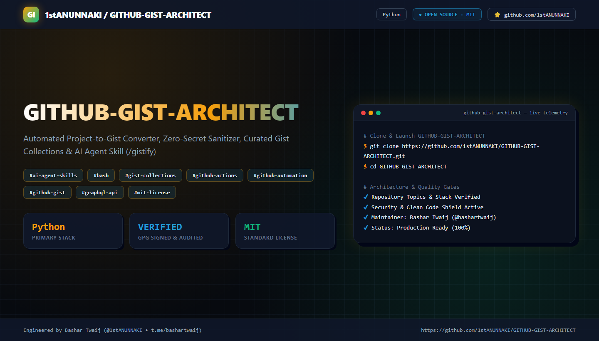

  

# 🏛️ GITHUB-GIST-ARCHITECT — محول المشاريع الذكي إلى GitHub Gists نظيفة ومفهرسة (النسخة العربية)

[-2563EB?style=for-the-badge)](./README.md)
[-10B981?style=for-the-badge)](./README_AR.md)

### 🛠️ اللغات والتقنيات البرمجية المستخدمة في صناعة المشروع

**المنظومة الهندسية المتكاملة لتحليل المشاريع البرمجية، تطهيرها من التوكنات والرموز الشخصية، وتحويل كل أداة ووظيفة فيها إلى GitHub Gist مستقل بعناوين بحثية قياسية (SEO-Optimized) ومجمّعة في قوائم مهام كبرى (Master Gist Lists).**

[🇬🇧 Primary English Documentation (`README.md`)](./README.md) · [📐 الخطة والمعمارية بالتفصيل](./docs/PLAN_AND_ARCHITECTURE_AR.md) · [📚 الفهرس العام والقوائم الثلاث](./collections/00_MASTER_GIST_CATALOG.md) · [🤖 مهارة الذكاء الاصطناعي (`SKILL.md`)](./skills/project-to-gist-converter/SKILL.md) · [⚖️ رخصة MIT (`LICENSE`)](./LICENSE)

---

## 🌟 1. ماذا يقدم هذا المستودع؟

يجمع هذا المستودع بين **مكتبة Gists قياسية جاهزة** (مستخلصة من أنظمتنا السابقة لأتمتة بروفايل GitHub، البطاقات الحية، طلبات السحب الموثقة بـ GPG عبر GraphQL، وفحص المستودعات المجتمعية) وبين **محرك ومهارة ذكاء اصطناعي (`/gistify`)** لتحويل أي مشروع مستقبلي إلى Gists خالية تماماً من التوكنات والبيانات الحساسة.

---

## 🛠️ 2. جدول اللغات والتقنيات البرمجية المستخدمة في المشروع

| اللغة / التقنية | دورها الهندسي في المشروع | الملفات والوحدات الرئيسية |
| :--- | :--- | :--- |
| **Python 3.10+** | محرك التطهير الأمني، محول المشاريع الآلي، مزامنة الإحصائيات الحية، هندسة طلبات السحب بـ GPG، وتوليد بطاقات الـ SVG | [`src/secret_sanitizer.py`](./src/secret_sanitizer.py)، [`src/project_to_gist_converter.py`](./src/project_to_gist_converter.py)، `gists/01..03`، `gists/05..09` |
| **PowerShell** | ترقية صلاحية `gist` تلقائياً عبر GitHub Device Flow ونشر كافة الـ Gists والقوائم دفعة واحدة إلى `gist.github.com` | [`scripts/Publish-AllGists.ps1`](./scripts/Publish-AllGists.ps1) |
| **Bash / Shell** | حارس التحقق المسبق (`HTTP 200 OK`) لمنع فشل إعادة نشر الإصدارات في خطوط CI/CD | [`gists/10_actions_binary_republish_guard/ci_idempotent_publish_guard.sh`](./gists/10_actions_binary_republish_guard/ci_idempotent_publish_guard.sh) |
| **YAML (GitHub Actions)** | جدولة المزامنة السحابية الدورية كل 6 ساعات لتحديث البروفايل والبطاقات آلياً | [`gists/04_github_actions_profile_cron/profile-metrics-auto-sync.yml`](./gists/04_github_actions_profile_cron/profile-metrics-auto-sync.yml) |
| **GitHub GraphQL API v4** | التوقيع الرقمي الرسمي (`createCommitOnBranch`)، جمع مساهمات كل السنوات، واعتماد إجابات النقاشات | `gists/01`، `gists/05`، `gists/06`، `gists/07` |
| **GitHub REST API v3** | استكشاف المستودعات المجتمعية، إدارة الوسوم (`Topics`)، ونشر حزم الـ Gists | `gists/08`، `scripts/Publish-AllGists.ps1` |
| **Dynamic SVG Vector** | توليد الرسوميات المتجهة لبطاقات السلسلة ومجرة المستودعات الحلزونية ثلاثية الأبعاد | `gists/02`، `gists/03` |

---

## 🗂️ 3. قوائم الـ Gists الكبرى (The 3 Master Gist Lists)

| رقم القائمة | اسم القائمة ومهمتها الكبرى | عدد الـ Gists | داخل المستودع | على `gist.github.com` |
| :-: | :--- | :-: | :---: | :---: |
| **الفهرس العام** | **الفهرس الرئيسي الشامل لجميع الـ Gists والقوائم** | `10 Gists` | [📂 الفهرس](./collections/00_MASTER_GIST_CATALOG.md) | [🌐 فتح الـ Gist](https://gist.github.com/1stANUNNAKI/b1b31e4a7f0a089ed7927620dedbdea5) |
| **List 01** | **منظومة أتمتة بروفايل GitHub والبطاقات الحية (Profile Telemetry & SVG Suite)** | `4 Gists` | [📂 القائمة 01](./collections/LIST_01_PROFILE_TELEMETRY_AND_SVG.md) | [🌐 فتح الـ Gist](https://gist.github.com/1stANUNNAKI/92f026f01535f414e4cfb76cd0720c01) |
| **List 02** | **منظومة هندسة طلبات السحب الموثقة والأوسمة (GraphQL GPG PR & Achievements Suite)** | `3 Gists` | [📂 القائمة 02](./collections/LIST_02_PR_AND_ACHIEVEMENTS_ENGINE.md) | [🌐 فتح الـ Gist](https://gist.github.com/1stANUNNAKI/d1ffe609069f8df2c2494a6596859cb6) |
| **List 03** | **منظومة فحص المستودعات المجتمعية والأمان الوقائي (Community Scanner & Security Suite)** | `3 Gists` | [📂 القائمة 03](./collections/LIST_03_COMMUNITY_SCANNER_AND_SECURITY.md) | [🌐 فتح الـ Gist](https://gist.github.com/1stANUNNAKI/07da8d4b142b6dba5c52bdff10a63930) |

---

## 📋 4. جدول الـ 10 Gists التفصيلية (مع الكود والرابط الحي على `gist.github.com`)

| # | عنوان الـ Gist البحثي (SEO Title) والوظيفة | ملف الكود النظيف | الرابط الحي على `gist.github.com` |
| :-: | :--- | :---: | :---: |
| **#01** | **Auto-Update GitHub Profile README Live Contributions & Streak Stats via GraphQL (Python)** _جلب إجمالي المساهمات الحقيقية عبر جميع السنوات والسلسلة اليومية عبر GraphQL وتحديث بطاقات البروفايل تلقائياً مع كسر الكاش._ | [`github_profile_live_metrics_sync.py`](./gists/01_profile_live_metrics_sync/github_profile_live_metrics_sync.py) | [🌐 فتح Gist #01](https://gist.github.com/1stANUNNAKI/4780a35129ec55227e736bba715e3f73) |
| **#02** | **Generate Custom GitHub Streak & Achievements Trophy SVG Cards Locally (Midnight Galaxy Theme - Python)** _توليد بطاقات SVG الإحصائية (`streak-stats.svg` و `trophies.svg`) محلياً داخل المستودع بألوان ثيم `Midnight Galaxy` الموحدة._ | [`github_custom_svg_cards_generator.py`](./gists/02_custom_svg_cards_generator/github_custom_svg_cards_generator.py) | [🌐 فتح Gist #02](https://gist.github.com/1stANUNNAKI/6bf795c7841b69a11dc2eb97f0aaefbe) |
| **#03** | **Generate Interactive 3D Spiral Galaxy SVG of GitHub Repositories & Languages (Python)** _رسم مجرة حلزونية فلكية (`repo-galaxy.svg`) تمثل جميع مستودعات الحساب كنجوم مضيئة مصنفة حسب لغات البرمجة وحجم النجوم._ | [`github_repo_galaxy_svg_visualizer.py`](./gists/03_repo_galaxy_svg_visualizer/github_repo_galaxy_svg_visualizer.py) | [🌐 فتح Gist #03](https://gist.github.com/1stANUNNAKI/d7f8a4a289e50e71bb24be84397a53da) |
| **#04** | **GitHub Actions Cron Workflow to Auto-Sync Profile README Stats Every 6 Hours (YAML)** _ملف سير عمل GitHub Actions يعمل تلقائياً كل 6 ساعات لتحديث إحصائيات البروفايل وبطاقات الـ SVG وعمل Commit آلي._ | [`profile-metrics-auto-sync.yml`](./gists/04_github_actions_profile_cron/profile-metrics-auto-sync.yml) | [🌐 فتح Gist #04](https://gist.github.com/1stANUNNAKI/c2de940528a5bb678e534529746694b0) |
| **#05** | **Create GPG-Verified GitHub Commits & Pull Requests via GraphQL createCommitOnBranch (Python)** _إنشاء التزامات موقعة رقمياً بعلامة `Verified` الرسمية من GitHub عبر GraphQL `createCommitOnBranch` مع دعم `Co-authored-by`._ | [`github_graphql_gpg_verified_pr_engine.py`](./gists/05_graphql_gpg_verified_pr_engine/github_graphql_gpg_verified_pr_engine.py) | [🌐 فتح Gist #05](https://gist.github.com/1stANUNNAKI/62f2233c827774d1c1ca9b948d09ee8b) |
| **#06** | **Create Answered GitHub Discussions & Mark Accepted Answer via GraphQL API (Python)** _أتمتة إنشاء النقاشات المعرفية (Q&A Discussions) واعتماد الإجابة المقبولة برمجياً عبر `markDiscussionCommentAsAnswer`._ | [`github_graphql_discussion_answer_automator.py`](./gists/06_graphql_discussion_answer_automator/github_graphql_discussion_answer_automator.py) | [🌐 فتح Gist #06](https://gist.github.com/1stANUNNAKI/a0e2150fc82fdf18d772769450a4d257) |
| **#07** | **Audit GitHub Profile Achievements & Merged PR Signature Status via GraphQL (Python)** _فحص وتدقيق حالة الأوسمة والشارات على حساب GitHub والتحقق من صحة التوقيع الرقمي وتذييلات المشاركة في طلبات السحب._ | [`github_achievements_progress_auditor.py`](./gists/07_github_achievements_progress_auditor/github_achievements_progress_auditor.py) | [🌐 فتح Gist #07](https://gist.github.com/1stANUNNAKI/d08890ebf4c009c6693519da37b2ae1f) |
| **#08** | **Discover Active Open-Source GitHub Repositories by Star Count & Owner Followers (Python)** _أداة البحث الذكي عن المستودعات مفتوحة المصدر النشطة ضمن نطاق نجوم ومتابعين محدد لتقديم مساهمات برمجية فعالة._ | [`github_community_repo_discovery_scanner.py`](./gists/08_community_repo_discovery_scanner/github_community_repo_discovery_scanner.py) | [🌐 فتح Gist #08](https://gist.github.com/1stANUNNAKI/254d6ff362da7fb7ec17ae5b0adaa3b7) |
| **#09** | **Sanitize Code Files & Strip API Tokens, PATs, and Personal Emails Before Publishing Gists (Python)** _الأداة الوقائية لتنظيف وتطهير أي ملف برمجي أو مشروع كامل من التوكنات والإيميلات والمعرفات الشخصية قبل نشره كـ Gist عام._ | [`gist_secret_and_token_sanitizer.py`](./gists/09_code_secret_and_token_sanitizer/gist_secret_and_token_sanitizer.py) | [🌐 فتح Gist #09](https://gist.github.com/1stANUNNAKI/058fec7fe849cdea5c050eeba2b16204) |
| **#10** | **Fix GitHub Actions Release Republish Failure with Pre-Flight HTTP 200 Check (Bash / YAML)** _حل مشكلة توقف خطوط النشر الآلي (CI/CD Release Pipelines) عبر فحص HTTP 200 المسبق وتخطي الرفع المكرر بأمان._ | [`ci_idempotent_publish_guard.sh`](./gists/10_actions_binary_republish_guard/ci_idempotent_publish_guard.sh) | [🌐 فتح Gist #10](https://gist.github.com/1stANUNNAKI/49cfbfd99f3cf0a15e9a90e2bad2482e) |

---

## ⚖️ 5. الرخصة (MIT License)

هذا المشروع مرخص بموجب رخصة **MIT License** القياسية — يمكنك الاطلاع على النص الكامل للرخصة في ملف [`LICENSE`](./LICENSE).
